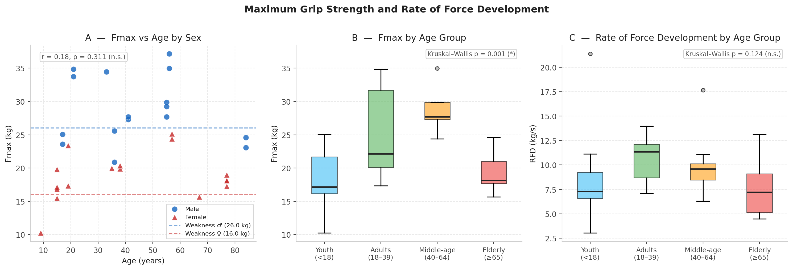
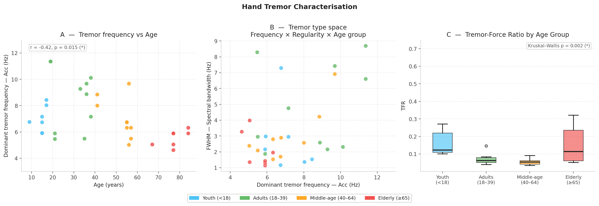
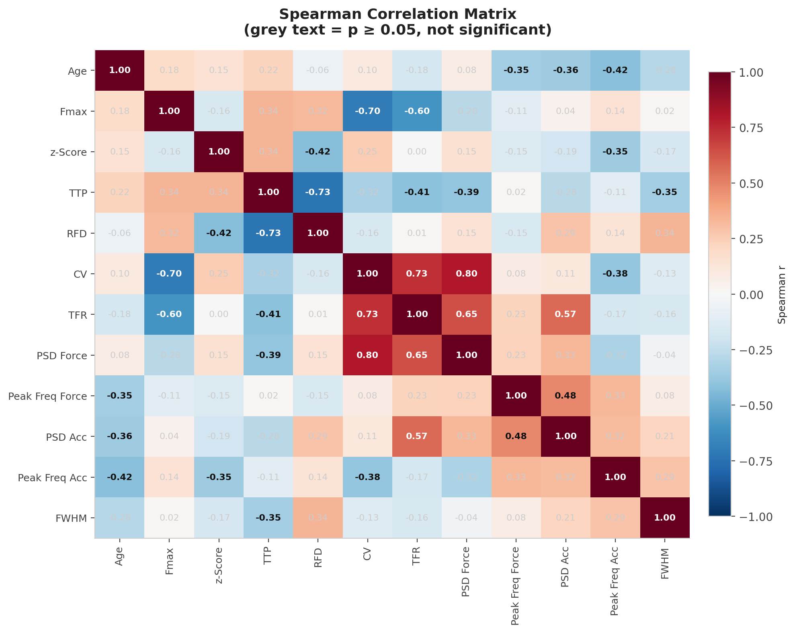

# 3D-Printed Dynamometer for Grip Strength, Force Steadiness and Hand Motor Control

A low-cost, portable device that measures **grip strength**, **force steadiness** and **hand tremor**.
A load cell (HX711) and an IMU (BMI270) are read by an Arduino, and a Python/Qt GUI guides the test and
analyses the signals in real time.

Course project for *Instrumentação e Aquisição de Biossinais* (IAB), MEBiom, Instituto Superior Técnico —
Group 10 (Afonso Carvalho, David Lopes). This is a student prototype, **not a validated or clinical device**.

## What it measures

- **Strength:** Fmax, time-to-peak, and z-score against the normative data of Dodds et al. (2014).
- **Force control:** coefficient of variation and force power spectrum (sub-maximal holds at 30 % of MVC).
- **Tremor:** accelerometer spectrum (2–15 Hz): peak frequency, FWHM, RMS, and tremor-to-force ratio (TFR).

Protocol: 3 maximum voluntary contractions (MVC, 5 s each), then 3 sub-maximal holds at 30 % of the MVC (20 s each).

## Repository layout

| Folder | Content |
|---|---|
| `firmware/` | Arduino sketches: acquisition and load-cell calibration |
| `software/gui/` | `grip_analyzer_gui.py` — test GUI (PySide6 + pyqtgraph) |
| `software/analysis/` | `grip_tremor_analysis.py` — group analysis that produces the figures |
| `hardware/` | `dynamometer_final.f3d` — Fusion 360 design of the final dynamometer |
| `docs/` | Report, poster, GUI screenshots |
| `data/` | Column template only (see [Data](#data)) |
| `results/figures/` | Example figures |

## Getting started

```bash
python -m venv .venv && source .venv/bin/activate      # Windows: .venv\Scripts\activate
pip install -r requirements.txt                        # needs NumPy >= 2.0
```

1. Calibrate with `firmware/calibration/`, then flash `firmware/acquisition/acquisition.ino`
   (libraries in `firmware/README.md`).
2. Edit the serial port in `software/gui/grip_analyzer_gui.py` (`serial.Serial("COM7", 115200)`).
3. Run the GUI from `data/`, because it appends results to `results.csv` in the **current directory**:

   ```bash
   cd data
   python ../software/gui/grip_analyzer_gui.py
   ```

## Demo mode vs. real protocol

The GUI ships with **`DEMO_MODE = True`**: all rest periods last **5 s** so the whole test can be shown quickly
in a presentation. This is **not** the real protocol. For actual measurements set `DEMO_MODE = False` at the top of
`software/gui/grip_analyzer_gui.py`:

| | Rest after each MVC | Rest after each sub-maximal hold |
|---|---|---|
| `DEMO_MODE = True` (default) | 5 s | 5 s |
| `DEMO_MODE = False` (real protocol) | 20 s | 60 s |

MVC (5 s) and sub-maximal hold (20 s) durations are the same in both modes.

## Data

Participant data is **not included** in this repository. `data/results_template.csv` contains the column header.

| Column | Meaning |
|---|---|
| `age`, `sex`, `height_cm`, `weight_kg` | Participant characteristics (`sex`: `M`/`F`) |
| `fmax`, `ttp` | Maximum force (kgf), time to peak (s) |
| `z_Score` | Grip strength z-score vs. Dodds et al. (2014) |
| `cv` | Coefficient of variation of the sub-maximal hold (%) |
| `psd_force`, `Peak_Freq_Force_Hz` | Force PSD power (kgf²/Hz, 0.1–4 Hz) and its peak frequency |
| `PSD_Acc_8_12Hz`, `Peak_Freq_Acc_Hz`, `FWHM`, `RMS` | Hand-tremor spectrum (g²/Hz, Hz, Hz) and RMS acceleration (g) |
| `TFR`, `TFR_std` | Tremor-to-force ratio (mean and standard deviation across windows) |

To run the analysis, put your own measurements in `data/results.csv` and run, from `data/`:

```bash
python ../software/analysis/grip_tremor_analysis.py   # writes figures to the current directory
```

## Example results

Figures from the project's own dataset (33–34 trials, ~18 participants; see the report for details):





GUI screenshot: [`docs/screenshots/gui_results_2026-04-06.png`](docs/screenshots/gui_results_2026-04-06.png).
Full methods and results: [`docs/IAB_report_3d_printed_dynamometer.pdf`](docs/IAB_report_3d_printed_dynamometer.pdf).
